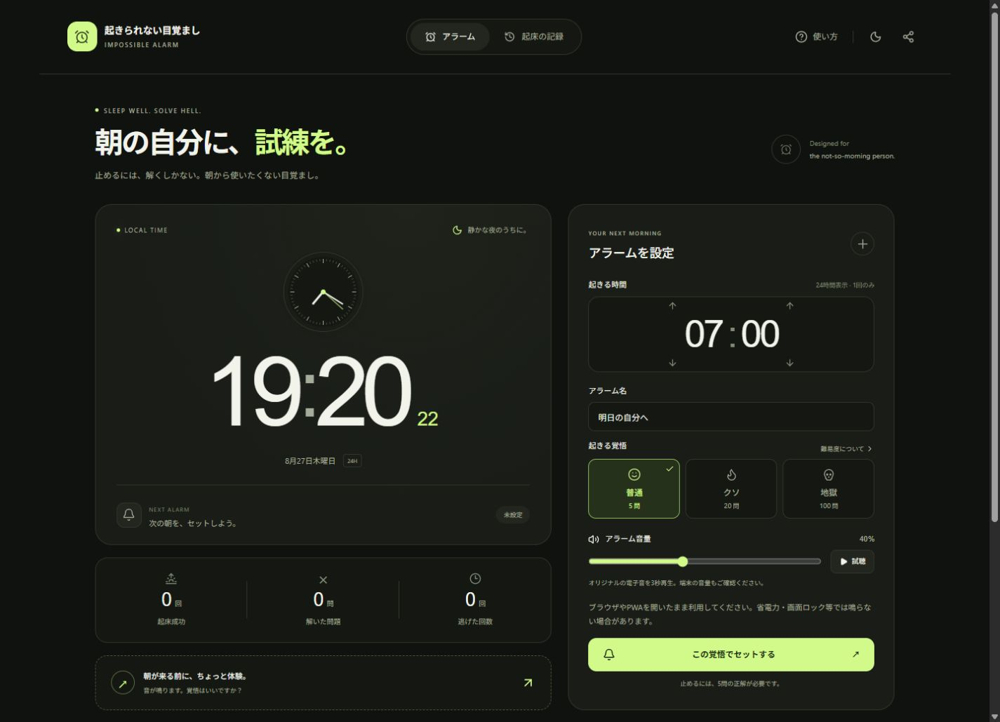
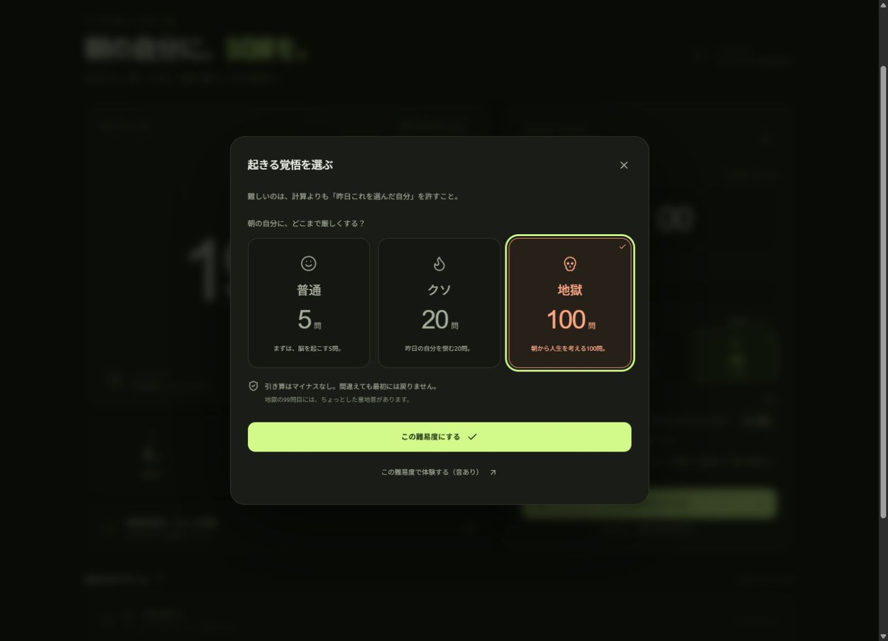
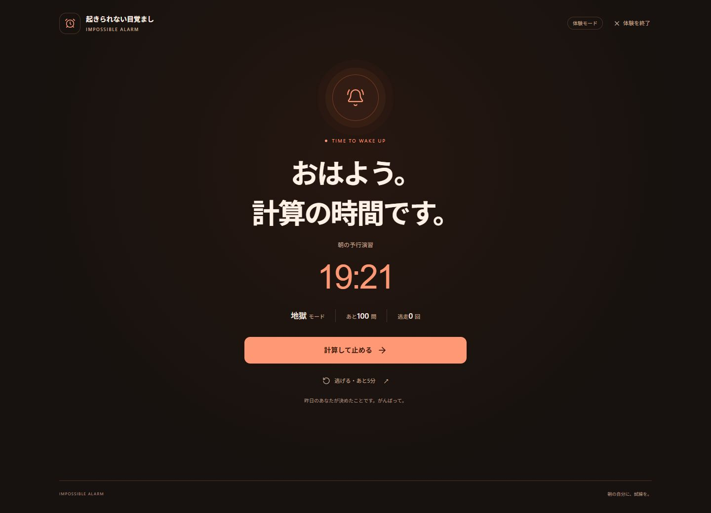
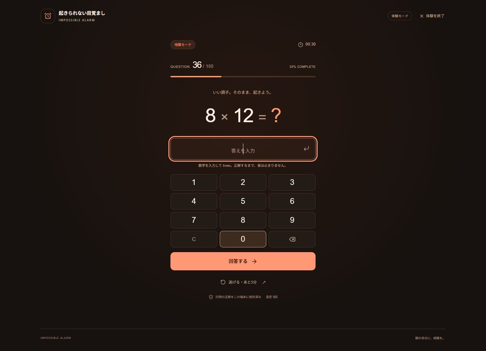
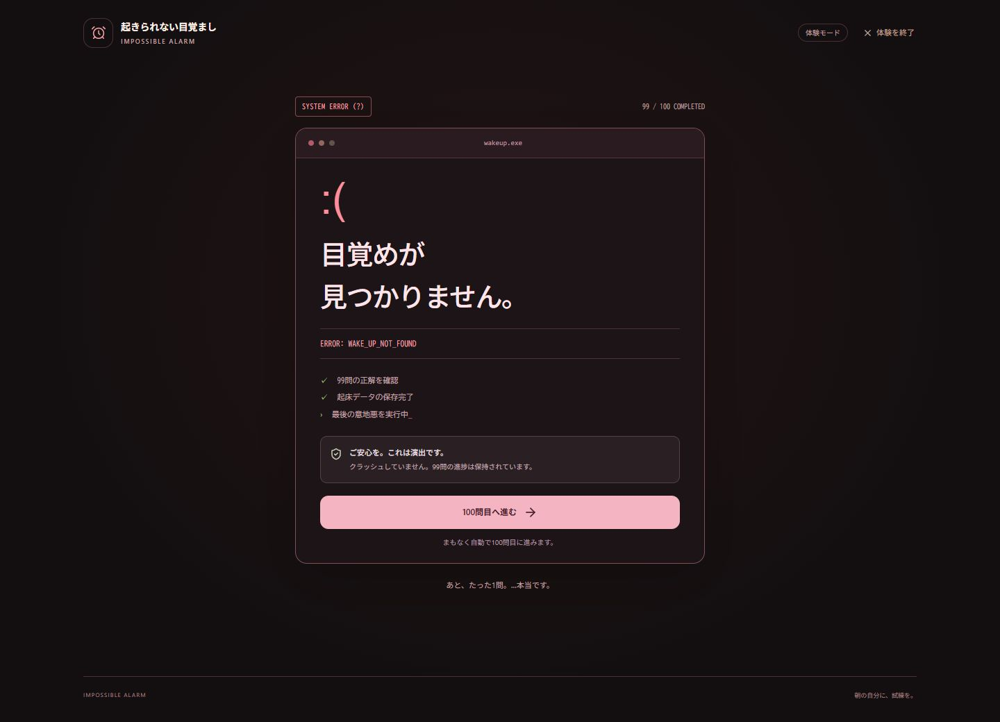

# 起きられない目覚まし

朝の自分に、試練を。高級時計のような静かな画面から、最大100問の計算が待つ朝へ。

「アラームを止めたいなら、まず計算」をテーマにした、モバイルファーストの目覚ましWebアプリです。見た目の落ち着きと、発火後の騒がしさのギャップを楽しむ個人制作です。

## 公開状況

2026年8月27日公開。アプリの認証なしHTTP 200、GitHubの公開状態、GitHub Actionsの成功を確認済みです。

- 公開アプリ：[impossible-alarm.vercel.app](https://impossible-alarm.vercel.app)
- 公開リポジトリ：[shunsoco-stack/impossible-alarm](https://github.com/shunsoco-stack/impossible-alarm)
- 掲載用の文章：[docs/publish-copy.md](docs/publish-copy.md)

## 最初にお読みください：Webアラームの制約

> **ブラウザやPWAを開いた状態での利用を推奨します。実用的な目覚ましとして、指定時刻の発火・音の再生・起床を保証するものではありません。大切な予定には端末標準のアラームを併用してください。**

- ブラウザやタブの終了、アプリの強制終了、端末のスリープ、画面ロック、省電力設定、バックグラウンド処理の制限などにより、アラームが鳴らない・遅れて鳴る場合があります。
- PWAをインストールしても、OS標準の目覚ましと同じ実行権限は得られません。Service Workerはオフライン表示を補助するもので、閉じたアプリを指定時刻に起動して鳴らす仕組みではありません。
- Web Audio APIは、クリックなどのユーザー操作による音声の有効化が必要です。再読み込みやブラウザ復帰後には、もう一度音声を有効にする操作が必要になる場合があります。
- 音量の事前確認は、その時点・その出力先での確認です。端末の消音、音量変更、Bluetooth機器の切り替えなどにより、後から聞こえなくなる場合があります。小さめの音量から確認してください。
- 通知は任意です。ユーザーが通知の許可操作を行い、ブラウザで許可した場合のみ利用します。通知の拒否や未対応環境でも計算画面は使えますが、通知がブラウザの停止や省電力制限を回避することはありません。
- 時刻は端末のローカル時刻を使用します。端末時計やタイムゾーンを変更した場合は、設定を確認してください。

## 主な機能

- 時刻・アラーム名・音量・難易度を指定。UIから保存できるアラームは最大8件です。
- アラームは一回限り。次に指定時刻を迎えた際に発火し、自動でオフになります。毎日の繰り返し機能はなく、再度使う場合は有効にし直します。
- Web Audio APIの発振器でオリジナルのアラーム音を合成。既存の楽曲、著作権のある音源、外部音声ファイルは使用しません。
- 足し算・引き算・掛け算を出題。正解するたびに進捗を保存し、必要な問題数を解くと通常停止できます。
- 「逃げる・あと5分」で5分スヌーズ。スヌーズ回数を記録し、解答済みの進捗は維持します。
- アラーム履歴は最新100件。デモと緊急停止は、通常の起床成功件数に含めません。
- 結果の共有、音の試聴、アラーム体験、99問目の演出体験。
- ダークモードを中心としたレスポンシブUI、キーボード操作、フォーカス表示、読み上げを考慮した状態通知、動きを抑える設定への配慮。
- アプリアイコン、favicon、OG画像、manifest、PWA対応。

### 難易度

| 表示名 | 内部ID   | 停止に必要な正解数 |
| ------ | -------- | ------------------ |
| 普通   | `normal` | 5問                |
| クソ   | `crap`   | 20問               |
| 地獄   | `hell`   | 100問              |

地獄モードでは、99問目を正解するとエラー風の演出が表示されます。**実際のシステムエラーやクラッシュではありません。** 解答済みの99問は保持され、演出を終えると100問目へ正常に進めます。故意にデータを壊したり、問題を最初からやり直させたりはしません。

### 安全のための緊急停止

計算を続けられない場合や音を直ちに止める必要がある場合に備え、緊急停止ボタンを用意しています。緊急停止は成功扱いにせず、履歴にも区別して保存します。音や演出がつらいと感じた場合は、無理をせず停止してください。

## 使い方

1. ブラウザまたはインストールしたPWAを開き、制約の案内を確認します。
2. アラーム名、時刻、難易度、音量を選び、事前に音を確認して保存します。
3. 必要な場合だけ通知を許可します。ブラウザやPWAを開いた状態で使用してください。
4. 発火したら計算問題に解答します。キーボード入力とEnterキーによる送信にも対応します。
5. 必要なら5分スヌーズ、すぐに止める必要があれば緊急停止を使用します。

同じアプリを複数タブで使うと混乱しやすいため、基本的には1つのタブで利用してください。Web Locks APIを利用できる環境では実行タブを調整しますが、未対応環境では単一タブでの利用が必要です。

## 保存データとプライバシー

アラーム設定、進行中の問題・正解数、スヌーズ回数、履歴、表示テーマは、そのブラウザの`localStorage`に保存します。ログイン、サーバーデータベース、端末間同期はありません。

- 保存領域を削除すると設定・進捗・履歴も失われます。別のブラウザや端末、別のURLには引き継がれません。
- プライベートブラウズや保存容量・権限の制限で保存できない場合は、画面で案内します。その場合の再読み込み後の復元は保証されません。
- 保存データは端末上で暗号化する設計ではありません。アラーム名に機密情報を入力しないでください。
- 共有機能はユーザーが操作した場合のみ実行します。送信先や内容を確認してから共有してください。
- Vercel Web Analyticsによるアクセス解析は、上記のローカル保存とは別の外部通信です。計算問題やアラーム設定をサーバーへ同期する仕組みではありません。

## Vercel Analyticsと無料プランの制約

`@vercel/analytics`で次のカスタムイベントを実装しています。開発環境とデモ操作は送信対象外とし、計測が利用できなくてもアラームの処理は継続します。

| イベント       | タイミング                         |
| -------------- | ---------------------------------- |
| `alarm_set`    | アラームの保存・再有効化           |
| `alarm_fire`   | 指定時刻の発火・スヌーズ後の再発火 |
| `alarm_stop`   | 通常停止または緊急停止。結果を区別 |
| `alarm_snooze` | 5分スヌーズの開始                  |

カスタム属性は`difficulty`、`snoozes`、`result`、`source`の範囲に限定し、1イベントにつき最大2属性としています。**アラーム名、設定時刻、問題文、答案、内部IDなどは送信しません。**

通常のページビュー計測はVercel公開プロジェクトで有効化済みです。ブラウザからの訪問後、集計APIで1訪問者・2ページビューの受信を確認しました。有料プランや有料アドオンへの変更は行っていません。

2026年8月27日の公式資料確認では、**Hobbyプランはカスタムイベントに非対応**です。現在の公開先チームはHobbyのため、イベント送信コードの実装と、Vercelダッシュボードでの実集計の完了は同義ではありません。カスタムイベントの実集計は未確認・プラン制約ありとして扱います。有料プランへの自動アップグレードや有料APIの導入は行いません。[Vercel公式：Web Analyticsの料金・制限](https://vercel.com/docs/analytics/limits-and-pricing)

将来、利用者自身がPro以上を選択する場合は、Web Analyticsの有効化と本番イベントの受信を別途確認してください。公式資料では通常Proは1イベント2属性、Web Analytics PlusとEnterpriseは8属性までです。属性数が上限を超えるイベントは送信設計を調整する必要があります。[Vercel公式：Web Analyticsの料金・制限](https://vercel.com/docs/analytics/limits-and-pricing)

## 技術構成

- Next.js 16.3.3 / React 19.2.8 / TypeScript
- Tailwind CSS 4 / Lucideアイコン
- Web Audio API / Notifications API / Web Share API
- localStorage / Web Locks API / Service Worker / Web App Manifest
- Vercel Analytics / Vitest / ブラウザ実機検証
- Node.js 22以上 / pnpm 11.19.0

このディレクトリは独立したNext.jsプロジェクトです。兄弟ディレクトリのアプリに依存しません。有料API、音源購入、データベースの設定、アプリ用APIキーは不要です。

## ローカル開発

Node.js 22以上とpnpm 11.19.0を用意し、このプロジェクトのルートで実行します。

```sh
pnpm install --frozen-lockfile
pnpm dev
```

ブラウザで`http://127.0.0.1:3000`を開きます。本番相当で確認する場合は次を実行します。

```sh
pnpm build
pnpm start
```

PWA、通知、共有などのWeb APIの可否はブラウザ・OSに依存します。HTTPSの公開URLまたはlocalhost系の開発環境で確認してください。Service Workerは本番ビルドで登録します。

## 品質確認・Secret Scan

2026年8月27日、以下の検査がすべて成功しました。GitHub Actionsでも同じチェックを実行しています。

| コマンド            | 確認内容                     | 最終結果  |
| ------------------- | ---------------------------- | --------- |
| `pnpm lint`         | ESLint・警告ゼロ             | 成功      |
| `pnpm typecheck`    | Next.js型生成・TypeScript    | 成功      |
| `pnpm test`         | 計算・状態遷移等の自動テスト | 223件成功 |
| `pnpm test:secrets` | 公開ソースの秘密情報候補検査 | 検出0件   |
| `pnpm build`        | 本番ビルド                   | 成功      |

`pnpm check`でも上記を順に実行できます。[CI](.github/workflows/ci.yml)は依存関係を`--frozen-lockfile`でインストールし、同じ検査を実行します。CI自体はデプロイや外部アカウントの変更を行いません。

[依存ライブラリ不要のスキャナ](scripts/secret-scan.mjs)は、実行ディレクトリ以下のソース・設定・文書を再帰走査します。`node_modules`、`.git`、`.next`、`.vercel`、依存キャッシュ、ビルド成果物、バイナリアセットなどは対象外です。既知形式のトークン、秘密鍵、認証情報の直書き候補、実値を含み得る`.env`ファイルを検出すると、ファイル名・行番号・ルール名だけを赤字表示し、終了コード1を返します。**検出した機密値自体は表示しません。**

`.env.example`などのテンプレートは内容を検査します。実際の`.env`や鍵をコミットしないでください。これは既知パターンによる予防的検査であり、秘密情報が存在しないことを保証するものではありません。

追加検査ではGitleaks 8.30.0による公開対象ソースとGit履歴の検査がともに検出0件。`pnpm audit`も全依存関係で既知の脆弱性0件でした。開発用画像ライブラリsharpは監査結果を受けて修正版0.35.4へ更新しています。

### 検証範囲

- 自動テスト223件：計算・保存形式112件、ストアと競合処理47件、音声・通知33件、Service Worker31件。
- ブラウザ：指定時刻の実発火、試聴、Enter回答、不正解、スヌーズ、再読み込み復帰、正常停止、履歴、99問目から100問目への自動復帰を確認。
- 320px・390px・1440px幅でレイアウトを確認。ダーク／ライトモード、Escapeでのダイアログ終了も確認。
- オンラインでキャッシュ準備後、ローカルサーバー停止中の再読み込みでも画面と保存履歴を復元できることを確認。
- 通知はブラウザでブロックされた環境で確認し、許可済み配送の分岐はモックでテストしています。OSごとの通知配送、ネイティブ共有先への送信、端末ごとの省電力条件・PWAインストール操作は未検証です。実機での確実な発火やアクセシビリティ認証を保証する検証ではありません。

アイコンとOG画像は公開済みファイルをそのまま利用します。再生成は日本語フォントが利用できる環境で `node scripts/generate-assets.mjs` を実行してください。本番ビルド時の再生成は不要です。

## スクリーンショット

以下の5枚は2026年8月27日に[公開アプリ](https://impossible-alarm.vercel.app)から取得しました。3〜5枚目は安全に試せる体験モードです。実際にUIから99問を正解して演出を撮影し、100問目の正常終了まで確認しています。途中35問正解時の再読み込みでも問題・進捗を保持しました。

### 1. 時計・アラーム設定



### 2. 難易度選択



### 3. アラーム発火



### 4. 計算問題



### 5. 99問目のエラー風演出



検証の詳細と未検証の範囲：[ブラウザ検証記録](docs/verification/browser-results.json)
